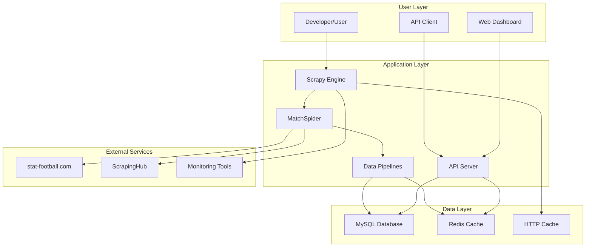
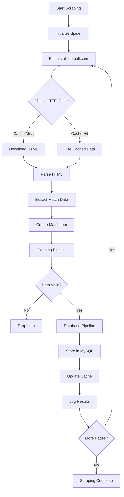
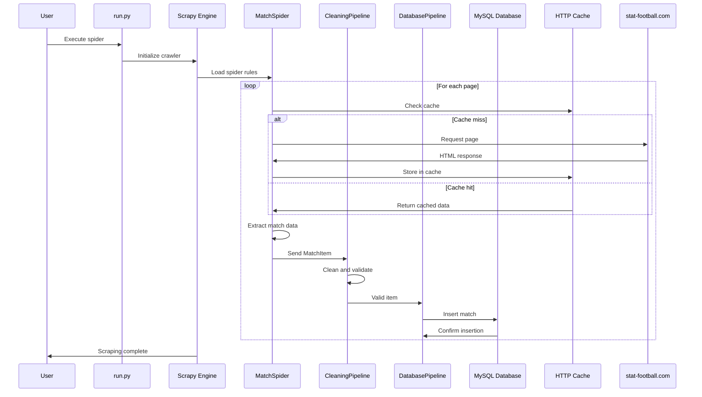
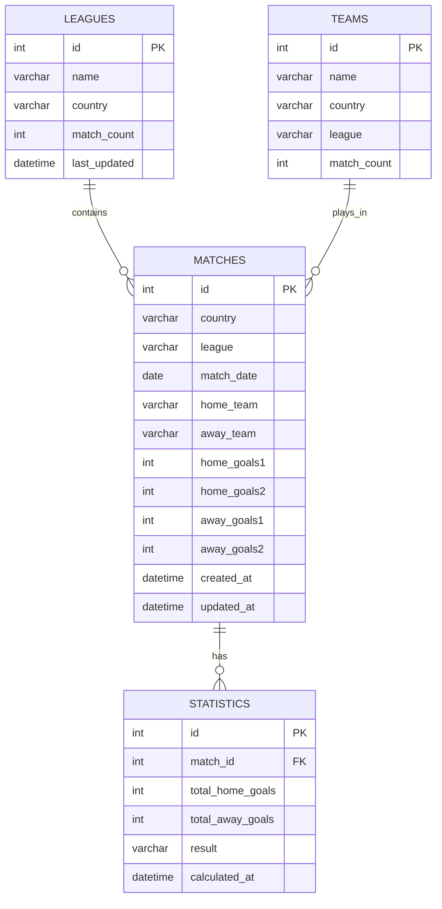
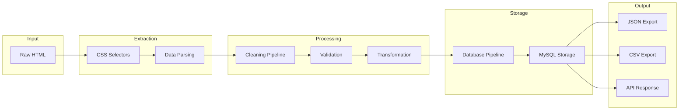
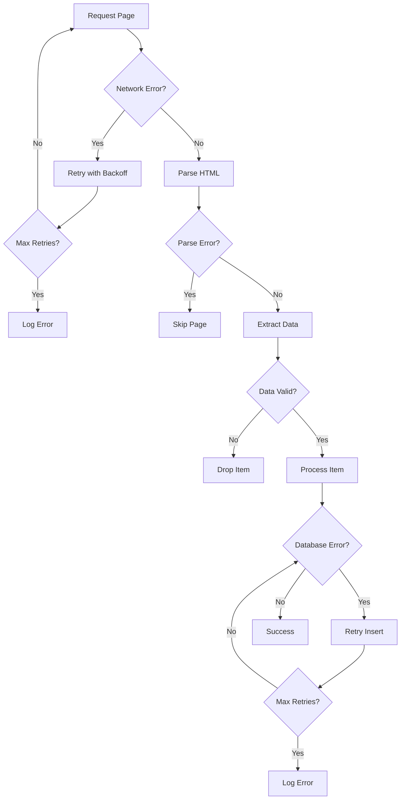
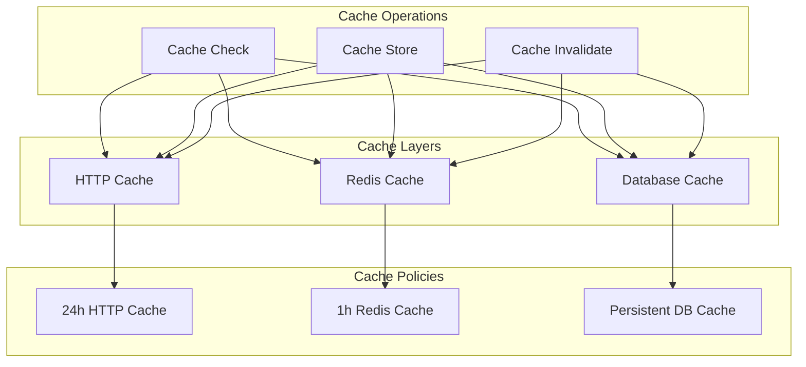
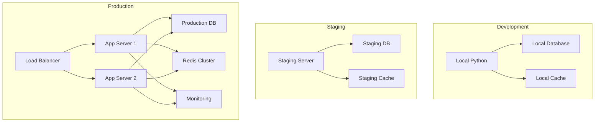
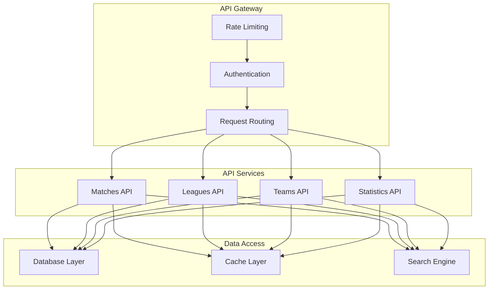
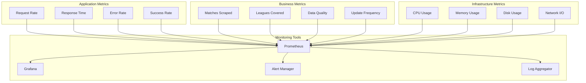

# System Architecture Diagrams

## 1. High-Level System Architecture

## 2. Data Flow Architecture

## 3. Component Interaction

## 4. Database Schema

## 5. Pipeline Architecture

## 6. Error Handling Flow

## 7. Caching Strategy

## 8. Deployment Architecture

## 9. API Architecture

## 10. Monitoring and Observability

