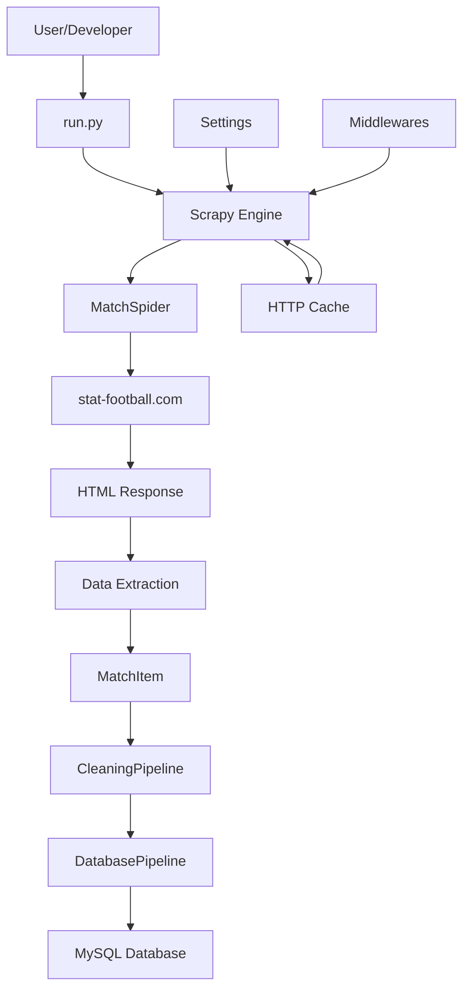
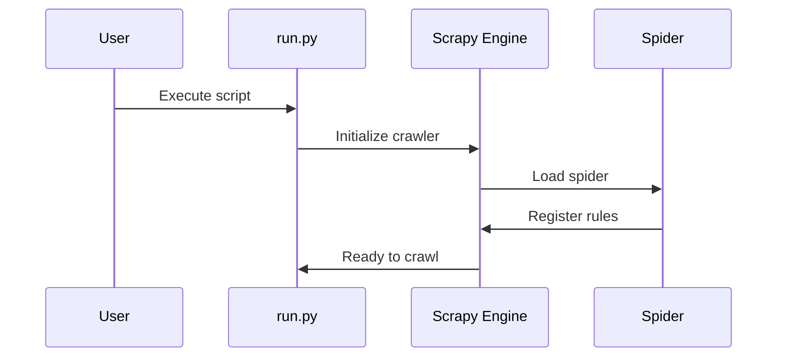
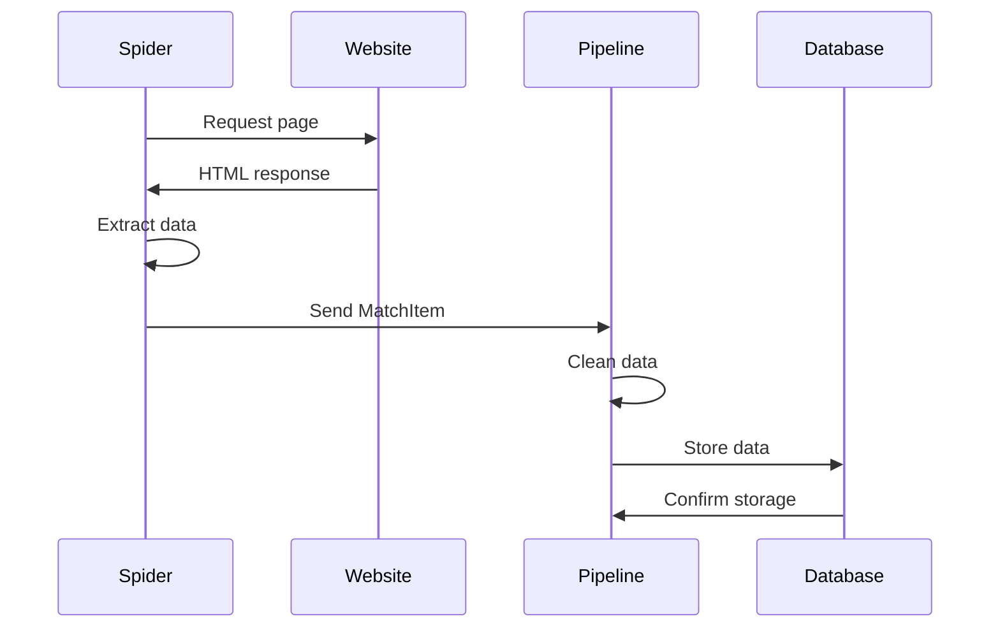

# Architecture Documentation

## System Overview

The Soccer Data Scraper is built using Scrapy, a powerful web scraping framework for Python. The system follows a modular architecture with clear separation of concerns, making it maintainable and extensible.

## Architecture Diagram



## Component Architecture

### 1. Entry Point (`run.py`)
- **Purpose**: Application entry point
- **Responsibilities**: 
  - Initialize Scrapy crawler
  - Execute the soccer spider
  - Handle command-line arguments

### 2. Spider (`MatchSpider.py`)
- **Purpose**: Core data extraction logic
- **Responsibilities**:
  - Define crawling rules and patterns
  - Extract data from HTML responses
  - Generate structured data items
  - Handle navigation through website structure

#### Crawling Strategy
The spider uses a two-level crawling approach:

1. **Level 1**: Navigate through league categories
2. **Level 2**: Extract match data from league pages

```python
rules = (
    # Level 1: Follow league links
    Rule(LinkExtractor(restrict_css="ul#menuA > li:not(.f11.t0.tar)"), follow=True),
    # Level 2: Extract match data
    Rule(LinkExtractor(restrict_css="td.im34.p0612 > nobr:nth-of-type(4)"), callback="populate_item")
)
```

### 3. Data Model (`items.py`)
- **Purpose**: Define data structure
- **Responsibilities**:
  - Define MatchItem schema
  - Ensure data consistency
  - Provide type hints for data fields

### 4. Processing Pipelines (`pipelines.py`)

#### CleaningPipeline
- **Purpose**: Data cleaning and validation
- **Responsibilities**:
  - Clean and normalize extracted data
  - Validate data quality
  - Filter out invalid matches
  - Transform data formats

#### DatabasePipeline
- **Purpose**: Data persistence
- **Responsibilities**:
  - Connect to MySQL database
  - Insert match data
  - Handle database transactions
  - Manage connection lifecycle

### 5. Configuration (`settings.py`)
- **Purpose**: System configuration
- **Responsibilities**:
  - Define spider settings
  - Configure pipelines
  - Set up HTTP caching
  - Manage user agents and robots.txt compliance

## Data Flow

### 1. Initialization


### 2. Data Extraction Process


## Caching Strategy

### HTTP Caching
- **Purpose**: Reduce server load and improve performance
- **Configuration**:
  - 24-hour cache expiration
  - Local file-based storage
  - Automatic cache invalidation

### Benefits
- Reduces requests to stat-football.com
- Improves development and testing speed
- Respects website resources

## Error Handling

### Spider Level
- **Invalid Data**: Drop items with missing or malformed data
- **Network Errors**: Automatic retry with exponential backoff
- **Parsing Errors**: Graceful handling with logging

### Pipeline Level
- **Data Validation**: Filter out invalid matches
- **Database Errors**: Transaction rollback and retry
- **Connection Issues**: Connection pooling and reconnection

## Performance Considerations

### Concurrent Requests
- **Default**: 16 concurrent requests
- **Configurable**: Adjustable via settings
- **Rate Limiting**: Respects robots.txt and server capabilities

### Memory Management
- **Streaming**: Process items as they're extracted
- **Garbage Collection**: Automatic cleanup of processed data
- **Resource Limits**: Configurable memory and CPU limits

## Security Measures

### Web Scraping Ethics
- **Robots.txt Compliance**: Respects website crawling policies
- **User-Agent Identification**: Proper bot identification
- **Rate Limiting**: Prevents server overload
- **Request Delays**: Configurable delays between requests

### Data Protection
- **Input Validation**: Sanitize all extracted data
- **SQL Injection Prevention**: Parameterized queries
- **Error Information**: Limited error details in production

## Scalability Considerations

### Horizontal Scaling
- **Multiple Instances**: Run multiple spider instances
- **Load Balancing**: Distribute requests across instances
- **Database Sharding**: Partition data by league or date

### Vertical Scaling
- **Resource Optimization**: Tune memory and CPU settings
- **Caching Layers**: Implement Redis for frequently accessed data
- **Database Optimization**: Indexes and query optimization

## Monitoring and Observability

### Logging
- **Structured Logging**: JSON format for easy parsing
- **Log Levels**: Configurable verbosity
- **Log Rotation**: Automatic log file management

### Metrics
- **Performance Metrics**: Request rates, response times
- **Data Quality Metrics**: Success rates, error counts
- **Business Metrics**: Matches scraped, leagues covered

## Deployment Architecture

### Development Environment
```
Local Machine
├── Python Environment
├── Scrapy Project
├── Local Database (optional)
└── HTTP Cache
```

### Production Environment
```
Server/Cloud
├── Scrapy Application
├── MySQL Database
├── Redis Cache (optional)
├── Monitoring Tools
└── Load Balancer (optional)
```

## Future Architecture Considerations

### Microservices
- **API Service**: REST/GraphQL endpoints
- **Scraping Service**: Dedicated scraping microservice
- **Data Service**: Data processing and analytics
- **Notification Service**: Alerts and updates

### Event-Driven Architecture
- **Message Queues**: Kafka/RabbitMQ for data flow
- **Event Sourcing**: Track all data changes
- **CQRS**: Separate read and write models

### Cloud-Native
- **Containerization**: Docker containers
- **Orchestration**: Kubernetes deployment
- **Serverless**: AWS Lambda for specific functions
- **Managed Services**: Cloud databases and caching